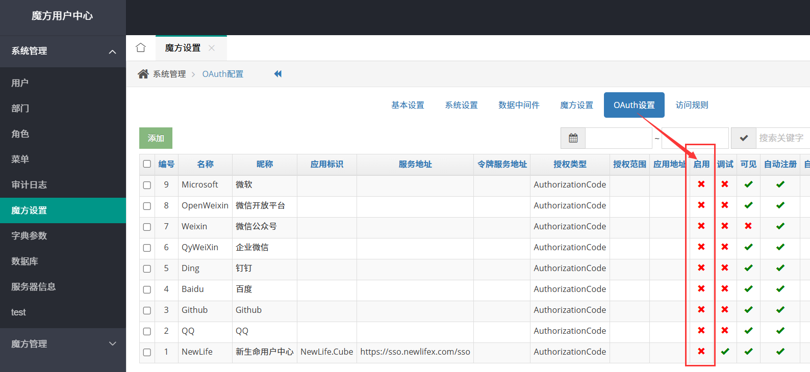

# 魔方 NewLife.Cube


[](https://github.com/NewLifeX/NewLife.Cube/actions/workflows/test.yml)
[](https://github.com/NewLifeX/NewLife.Cube/actions/workflows/aot.yml)
<!-- metrics:start -->
[](Doc/AOT兼容性分析.md)
[](https://www.nuget.org/packages/NewLife.Cube)
[](Doc/多语言本地化.md)
<!-- metrics:end -->


[](https://github.com/NewLifeX/NewLife.Cube/graphs/contributors)

<!-- lang:start -->
🌐 [English](README.md) | [繁體中文](README.zh-TW.md) | [Español](README.es.md) | [Deutsch](README.de.md) | [日本語](README.ja.md) | [Français](README.fr.md) | [Português](README.pt.md) | [Русский](README.ru.md) | [한국어](README.ko.md) | [العربية](README.ar.md)
<!-- lang:end -->

魔方是一个快速 Web 开发平台，面向“数据驱动 + 快速迭代 + 可深度定制”场景。几分钟内即可把实体 / 数据库表转为带权限、列表、详情、增删改、导出、统计的完整后台界面，并开放标准 API 给 Vue / Blazor / Antd / 移动端或第三方系统调用。默认模板已在真实项目中经历单表 100 亿数据增删改查考验。

演示站点：<https://cube.newlifex.com> `CentOS7 + CDN` · SSO中心：<https://sso.newlifex.com> `OAuth 服务端` · Swagger：[https://cube3.newlifex.com](https://cube3.newlifex.com)  

魔方教程：<https://newlifex.com/cube> · XCode教程：<https://newlifex.com/xcode> · 核心库教程：<https://newlifex.com/core>

> ℹ️ 本中文版与 [English README](README.md) 同批维护；若两者内容不一致，以英文版为对外口径。

**目录**：[快速开始](#快速开始) · [主要功能](#主要功能) · [生态版图](#生态版图) · [文档与示例](#文档与示例) · [参与贡献](#参与贡献) · [新生命开发团队](#新生命开发团队) · [许可证](#许可证)

## 快速开始

### 安装

通过 NuGet 引入 `NewLife.Cube.Core`。MIT 协议，可私有化替换字符串“NewLife”。支持 VS 与 CLI。`newlife.snk` 已公开便于强命名一致性。

```bash
dotnet add package NewLife.Cube
```

### 模板脚手架

```
dotnet new install NewLife.Templates
dotnet new cube --name CubeWeb
dotnet new xcode --name Zero.Data
cd CubeWeb
dotnet build
start http://localhost:6080
dotnet run
```

### 最小示例（.NET 8/9 Minimal Hosting）

```csharp
var builder = WebApplication.CreateBuilder(args);
builder.Services.AddCube(); // 注册权限、菜单、实体控制器扫描
var app = builder.Build();
app.UseMetronic(app.Environment); // or UseAdminLTE / UseTabler ...
app.UseCube(app.Environment);      // 路由 & 静态资源 & 中间件
app.Run();
```

访问 `/` 登录后台；Swagger 查看接口；前端可调用标准 CRUD API。

### 平台支持

| 项目 | 覆盖范围 |
| --- | --- |
| 目标框架 | 单包 5 个：net6.0、net7.0、net8.0、net9.0、net10.0 |
| 系统与架构 | Windows、Linux、macOS；x64、x86、arm64、arm、loongarch64、riscv64、s390x |
| 数据库 | MySql / SQLite / SqlServer / Oracle / PostgreSql / SqlCe / Access / 达梦 |
| NativeAOT | 非 MVC 底座 18 个冒烟场景（JIT/AOT 双跑），当前数量见上方徽章 |

### ASP.NET Core 安装

* 在 *Visual Studio* 中新建`ASP.NET Core Web`项目
* 通过 *NuGet* 引用`NewLife.Cube.Core`，或自己编译最新的[魔方 NewLife.CubeNC](http://github.com/NewLifeX/NewLife.Cube)源码
* 在`appsettings.json`的`ConnectionStrings`段设置名为`Membership`的连接字符串，用户角色权限菜单等存储在该数据库
* 系统自动识别数据库类型，默认`Data Source=..\Data\Membership.db`
* 编译项目，项目上点击鼠标右键，`查看`，`在浏览器中查看`，运行魔方平台
* 系统为`MySql`/`SQLite`/`Oracle`/`SqlCe`数据库自动下载匹配（`x86/x64`）的数据库驱动文件，驱动下载地址可在`Config\Core.config`中修改`PluginServer`
* 系统自动下载脚本样式表等资源文件，下载地址可在`Config/Cube.config`中修改`PluginServer`
* 默认登录用户名是`admin`，密码是`admin`，也可以使用`NewLife`等第三方OAuth登录，首个进入系统的用户抢得管理员，原`admin`禁用
* 项目发布时只需要拷贝`*.dll`、`appsettings.json`、`*.deps.json`、`*.runtimeconfig.json`，以及其它自己添加的资源文件

### ASP.NET MVC 安装

* 在 *Visual Studio* 中新建`ASP.NET MVC`项目
* 通过 *NuGet* 引用`NewLife.Cube`，或自己编译最新的[魔方 NewLife.Cube](http://github.com/NewLifeX/NewLife.Cube)源码
* 在`Web.config`的`<connectionStrings>`段设置名为`Membership`的连接字符串，用户角色权限菜单等存储在该数据库
* 系统自动识别数据库类型，默认`<add name="Membership" connectionString="Data Source=..\Data\Membership.db" providerName="Sqlite"/>`
* 编译项目，项目上点击鼠标右键，`查看`，`在浏览器中查看`，运行魔方平台
* 系统为`MySql`/`SQLite`/`Oracle`/`SqlCe`数据库自动下载匹配（`x86/x64`）的数据库驱动文件，驱动下载地址可在`Config\Core.config`中修改`PluginServer`
* 系统自动下载脚本样式表等资源文件，下载地址可在`Config/Cube.config`中修改`PluginServer`
* 默认登录用户名是`admin`，密码是`admin`，也可以使用`NewLife`等第三方OAuth登录，首个进入系统的用户抢得管理员，原`admin`禁用
* 推荐安装 *Visual Studio* 插件 *Razor Generator*，给`.cshtml`文件设置`自定义工具`为`RazorGenerator`，可以把`.cshtml`编译生成到`DLL`里面
* 项目发布时只需要拷贝`Bin`、`web.config`、`Global.asax`，以及其它自己添加的资源文件

## 主要功能

<details>
<summary><b>数据到界面生产力</b>（9 项）</summary>

| 功能 | 关键特性 |
| --- | --- |
| EntityController 脚手架 | 实体类 + 控制器 = CRUD / 统计 / 导出 / 权限 即刻可用；只读列表用 `ReadOnlyEntityController`。 |
| 静态构造定制 | 通过控制器静态构造器配置字段、操作按钮、关联跳转、统计、导出。 |
| 字段元数据接口 | `meta`（页面设置 + 列表 / 详情 / 新增 / 编辑 / 搜索字段）驱动动态前端生成，无需硬编码。 |
| 菜单树 | `/Cube/MenuTree` 按权限生成多级菜单；传统 MVC 界面使用 `/Admin/Index/GetMenuTree`。 |
| 统一响应 | `ApiResponse` 统一包装 code / data / page / stat。 |
| 免部署 | 首次运行自动创建数据库表结构与初始化数据，无需人工干涉。 |
| 强大视图引擎 | 子项目同路径同名 `.cshtml` 即可覆盖父项目视图，任意定制默认界面。 |
| 内置编辑器 | 富文本（Quill）与 Markdown（EasyMDE）双编辑器，支持图片上传与安全控制。 |
| Scalar 接口文档 | 集成 Scalar 在线文档，配合 Swagger 按区域自动分组，接口在线调试更便捷。 |

</details>

<details>
<summary><b>字段与界面定制</b>（3 项）</summary>

| 功能 | 关键特性 |
| --- | --- |
| 字段集合定制 | `ListFields.RemoveField` / `AddListField` 按控制器调整列、链接与打开方式。 |
| 修改日志 | `LogOnChange = true` 为每次修改写入审计记录。 |
| 前端动态字段 | 前端调用 `/Cube/App/meta` 获取页面元数据与字段定义，无需硬编码。 |

```csharp
public class AppController : EntityController<App, AppModel>
{
    static AppController()
    {
        LogOnChange = true;                 // 修改日志
        ListFields.RemoveField("Secret");   // 隐藏敏感列
        var log = ListFields.AddListField("Log", "UpdateUserId");
        log.DisplayName = "修改日志";
        log.Url = "/Admin/Log?category=应用系统&linkId={ID}";
        log.Target = "_blank";
    }
}
```

</details>

<details>
<summary><b>API 与前后端分离</b>（6 项）</summary>

| 接口 | 用途 |
| --- | --- |
| `/Auth/Login` | 登录并获取 JWT Token（Header / Cookie / Query）。 |
| `/Cube/MenuTree` | 按权限生成菜单树。 |
| `/{Area}/{Controller}/meta` | 列表 / 详情 / 新增 / 编辑表单的字段元数据。 |
| 主路由 + 动态参数 | 支持分页、排序与条件拼装查询。 |
| `GET {id}` / `POST` / `PUT {id}` / `DELETE {id}` | RESTful 子资源式增删改查；基路径批量删除，另有 `charts` / `export` / `import` / `attachments` 子资源。 |
| `stat` / `page` | 统计行与分页信息。 |

</details>

<details>
<summary><b>权限与安全</b>（7 项）</summary>

| 功能 | 关键特性 |
| --- | --- |
| 通用权限管理 | 用户、角色、菜单、权限，支持控制器 Action 粒度控制。 |
| EntityAuthorize | 每个动作执行登录 + 角色 + 菜单 Action 校验。 |
| 首个用户即管理员 | 首个进入系统的用户抢得管理员，原 `admin` 禁用；首次可用 `admin/admin` 登录。 |
| 统一身份 | 支持外部 OAuth / SSO / JWT，多端统一身份。 |
| 安全防御 | 内置威胁检测（扫描器 / 注入 / 蜜罐）、持久化自动封禁（阶梯时长）与安全事件审计。默认自动模式：连续攻击自动封禁、大范围攻击临时拦截并自动回落；可配置或自动学习可信代理防伪造；可一键切换观察 / 拦截模式。 |
| 生产建议 | 关闭未用第三方登录、启用 HTTPS、加强密码策略。 |
| 多租户开关 | 多租户能力可一键开关，关闭后隐藏租户菜单与字段，支持运行时租户切换。 |

</details>

<details>
<summary><b>AI 能力</b>（4 项）</summary>

| 功能 | 关键特性 |
| --- | --- |
| AI 对话助手 | 右下角对话面板统一入口，上下文感知（当前页面 / 实体 / 查询）。全局 `AiController.AiChat` 端点（`/Ai/AiChat`）+ NAI `AiChatService` 编排（会话历史 `ChatSessionService` 保持 / 工具循环 / SSE 事件流）。 |
| 扩展点 | 实体控制器经 `IEntityAiContext` 能力接口向全局端点暴露数据查询 / 工具集 / 提示词重载点（`SearchData` / `CreateCubeTools` / `BuildChatSystemPrompt`）。工具集含 `get_data_context`、`get_form_schema`、`fill_form`、`get_page_context`、`get_system_info` 与 `run_js`。 |
| AI 洞察 | 原 `AiInsight` 独立端点已合并到对话助手，数据收集保留 `AiInsightHelper`（14 类敏感字段黑名单）。一键 AI 分析提供自动统计、异常检测、趋势预判与可执行建议，支持深度推理，MVC / Vue 双端适配。 |
| 工作台 Widget | 工作台 / 首页由可配置部件（KPI、图表、监控）组成，支持个性化布局与 `/Cube/Widget` 部件管理。 |

</details>

<details>
<summary><b>前端、主题与皮肤</b>（7 项）</summary>

| 功能 | 关键特性 |
| --- | --- |
| 多前端共存 | Vue（官方）、8 套仓库内参考 SPA 皮肤与传统 Razor 可渐进迁移；React（Ant Design）由独立仓库 CubeAntd 维护；Blazor 为已冻结的 MVC 主题实验。 |
| 主题内嵌资源 | `CubeEmbeddedFileProvider` 把主题静态资源打包进程序集。 |
| 皮肤注册 | `AddTheme/AddSkin` 注册皮肤，Use 阶段任选其一（`app.UseMetronic(env)` 等）。 |
| 自定义主题 | 仿照 `MetronicModule` 实现 IModule 并在 Use 阶段挂载。 |
| 视图覆写 | 子项目同路径同名 `.cshtml` 覆盖父级。 |
| 多语言 | 11 种运行时语言用于接口消息，按请求识别区域，并提供 11 语言 Vue 前端。 |
| 新一代皮肤包 | 基于 pnpm workspace + 公共模块 `@newlifex/cube`（统一 API / Token / 类型、字段元数据 → 控件映射）。`NewLife.Cube.Vue` 为官方皮肤；8 套 SPA 皮肤为仓库内参考实现，不发布 NuGet，构建其 `web` 后引用 .NET 项目；React 皮肤独立为 CubeAntd 仓库。 |

| NuGet 包 | 框架 | UI 库 | 开发端口 |
|---------|------|-------|---------|
| `NewLife.Cube.NaiveUI` | Vue 3 | Naive UI | 5180 |
| `NewLife.Cube.MUI` | React 19 | MUI 6 (Material) | 5181 |
| `NewLife.Cube.Shadcn` | React 19 | Radix UI + Tailwind CSS 4 | 5182 |
| `NewLife.Cube.ArcoVue` | Vue 3 | Arco Design Vue (字节) | 5183 |
| `NewLife.Cube.Angular` | Angular 19 | NG-ZORRO (Ant Design) | 5184 |
| `NewLife.Cube.Vuetify` | Vue 3 | Vuetify 3 (Material) | 5185 |
| `NewLife.Cube.Svelte` | SvelteKit 2 + Svelte 5 | Tailwind CSS 4 | 5186 |
| `NewLife.Cube.TDesign` | Vue 3 | TDesign (腾讯) | 5187 |

```csharp
// 使用示例（任选其一）
app.UseNaiveUI(app.Environment);
app.UseMUI(app.Environment);
app.UseShadcn(app.Environment);
app.UseArcoVue(app.Environment);
app.UseAngular(app.Environment);
app.UseVuetify(app.Environment);
app.UseSvelte(app.Environment);
app.UseTDesign(app.Environment);
```

前端 workspace 构建约定：

- 仓库根目录 `pnpm build`：仅构建 `packages/` 下公共模块，不再默认递归编译所有皮肤。
- 仓库根目录单皮肤构建：使用 `pnpm build:vue`、`pnpm build:naive`、`pnpm build:mui`、`pnpm build:shadcn`、`pnpm build:arco`、`pnpm build:angular`、`pnpm build:vuetify`、`pnpm build:svelte`、`pnpm build:tdesign`。
- 仓库根目录单皮肤开发：使用对应的 `pnpm dev:xxx`。
- 需要一次性构建或启动全部前端时，显式使用 `pnpm build:all` 或 `pnpm dev:all`。
- 若已进入具体皮肤目录 `web/`，继续使用该目录下的 `pnpm build` / `pnpm dev` 即可，互不干扰。

</details>

<details>
<summary><b>多数据库与大数据</b>（5 项）</summary>

| 功能 | 关键特性 |
| --- | --- |
| XCode 数据层 | 实体同步建表、字段演进、自动分表、读写分离、二级缓存。 |
| 多数据库 | MySql / SQLite / SqlServer / Oracle / PostgreSql / SqlCe / Access / 达梦。 |
| 三库分离 | 示例：Membership（权限）/ Cube（业务）/ Log（日志）。 |
| PluginServer | 首次运行自动下载数据库驱动与前端资源，可自定义地址。 |
| 规模验证 | 真实项目单表 100 亿数据增删改查。 |

</details>

<details>
<summary><b>性能与 NativeAOT</b>（4 项）</summary>

| 功能 | 关键特性 |
| --- | --- |
| 统一耗时记录 | 过滤器统一记录耗时，易接入 Stardust APM。 |
| 低成本日志 | 日志判级避免无谓字符串拼接。 |
| 多 TFM 优化 | 多目标框架允许在高版本启用 Span / ValueTask 优化。 |
| NativeAOT | 非 MVC 底座 18 个冒烟场景，CI 中按 JIT / AOT 双跑。 |

</details>

<details>
<summary><b>部署与运维</b>（5 项）</summary>

| 场景 | 做法 |
| --- | --- |
| 单机 | `dotnet publish` 后拷贝 dll + 配置即可。 |
| 服务 | 结合 `NewLife.Agent` 安装为 Windows Service 或 systemd。 |
| 集群 | 发布后打 zip 包，通过星尘代理 `StarAgent` 拉起守护，或通过星尘平台发布。 |
| 容器 | 简单 Dockerfile（复制发布目录，设置环境变量）。 |
| 横向扩展 | 无状态多实例，共享数据库 & 缓存。 |

#### 快速部署用户中心

1. 拉取[源码](https://github.com/NewLifeX/NewLife.Cube)并编译CubeSSO项目，切换到输出目录Bin/SSO，按需修改appsettings.json配置，打包exe/dll/appsettings.json/CubeSSO.runtimeconfig.json等文件，并发布到服务器。
```json
{
  "Logging": {
    "LogLevel": {
      "Default": "Information",
      "Microsoft.AspNetCore": "Warning"
    }
  },
  "AllowedHosts": "*",
  "Urls": "http://*:8080;https://*:8081",
  //"StarServer": "http://star.newlifex.com:6600",
  "ConnectionStrings": {
    "Membership": "Data Source=..\\Data\\Membership.db;provider=sqlite",
    "Cube": "Data Source=..\\Data\\Cube.db;provider=sqlite",
    "Log": "Data Source=..\\Data\\Log.db;provider=sqlite"

    //"Membership": "Server=.;Port=3306;Database=Membership;Uid=root;Pwd=root;provider=mysql",
    //"Cube": "Server=.;Port=3306;Database=Membership;Uid=root;Pwd=root;provider=mysql",
    //"Log": "Server=.;Port=3306;Database=Membership;Uid=root;Pwd=root;provider=mysql"
  }
}
```
2. 启动并访问SSO系统，首次登录可以用admin/admin进去，也可以使用第三方登录（新生命用户中心），第一个用户将会作为系统管理员，同时禁用admin。
3. 作为用户中心正式部署时，需要关闭SSO的第三方登录，魔方设置->OAuth设置->禁用所有。
   
4. 修改系统名称为新生命用户中心，魔方设置->系统设置->显示名称。

</details>

<details>
<summary><b>第三代魔方</b>（5 项）</summary>

| 事项 | 说明 |
| --- | --- |
| 聚焦 | 前后端分离 + 多前端生态 + 最小侵入。 |
| 后端 | 接口合并在 master（`NewLife.Cube`）；MVC 保留在 `NewLife.CubeNC`。 |
| 前端 | 仓库独立（Vue / QuickVue / Antd / Blazor）。 |
| 目标蓝图 | 现代化 UI + 保留覆写机制；多框架前端（Vue/React/Angular/Svelte + 8 套开箱即用皮肤包）；NuGet 引包即得默认皮肤；移动端 & 小程序 & 混合应用；数据大屏增强。 |
| 待办任务 | <https://github.com/orgs/NewLifeX/projects/1> |

前端仓库：  
https://github.com/NewLifeX/NewLife.CubeVue · https://github.com/NewLifeX/NewLife.QuickVue · https://github.com/NewLifeX/NewLife.CubeAntd · https://github.com/NewLifeX/NewLife.CubeBlazor

在线站点：Vue <https://vue.newlifex.com>、<https://quickvue.newlifex.com> · Antd <https://antd.newlifex.com> · Swagger <https://cube3.newlifex.com/swagger/index.html>

项目参与须知：

1. 加入 NewLifeX 团队，向 dev 分支提交。
2. WebApi 后台：`NewLife.Cube`；MVC 保留在 `NewLife.CubeNC`。
3. 新前端独立仓库（如 `NewLife.CubeAntd`）。
4. 文档/代码标注负责人。
5. 待办任务：https://github.com/orgs/NewLifeX/projects/1 。

春雨计划（里程碑摘录）：

- [*] 新建 WebApi 项目 `NewLife.Cube`
- [*] 迁移 NetCore 专属代码到 `NewLife.CubeNC`
- [*] 新版 `EntityController` / `EntityReadonlyController`
- [*] 接口文档 & Vue 登录主页
- [] Vue 用户/角色列表与表单

</details>

<details>
<summary><b>总体架构与子工程</b>（9 项）</summary>

```
+-------------------------------------------------------------+
|         前端 (Vue / Blazor / Antd / 传统 Razor UI)           |
+----------------------+------------------+-------------------+
|  皮肤视图(Razor)     |  API Controllers | Swagger 分组文档  |
+----------------------+------------------+-------------------+
|  EntityController / ReadOnlyEntityController 基础能力        |
+------------------+---------------------+--------------------+
| 权限(EntityAuthorize) | 过滤(ApiFilter) | 统一响应(ApiResponse)|
+-------------------------------------------------------------+
|            实体 & 业务逻辑 (XCode ORM + 扩展)                |
+-------------------------------------------------------------+
| 数据访问：MySql/SqlServer/SQLite/Oracle/PostgreSQL/达梦等    |
+-------------------------------------------------------------+
| NewLife.Core(日志/配置/缓存/序列化/追踪) + 生态组件          |
+-------------------------------------------------------------+
```

| 子工程 | 职责 |
| --- | --- |
| NewLife.Cube | 核心（实体控制器、权限、菜单、字段元数据、API）。 |
| NewLife.CubeNC | 旧版 MVC / Razor 兼容层。 |
| 经典皮肤 | AdminLTE / Metronic / Metronic8 / Tabler / LayuiAdmin / ElementUI / Blazor（各独立包）。 |
| 新一代皮肤 | pnpm workspace：NaiveUI / MUI / Shadcn / ArcoVue / Angular / Vuetify / Svelte / TDesign。 |
| NewLife.Cube.Swagger | 按区域自动分组的 Swagger 文档。 |
| CubeDemo / CubeDemoNC | 示例。 |
| CubeSSO | 统一用户中心 & OAuth 服务端。 |
| NewLife.Cube.Blazor | Blazor 实验（已冻结的 MVC 主题）。 |
| Test / XUnitTest / NewLife.Cube.Tests / E2EMvcTest / AotSmoke / WebSmoke | 测试与验证（WebSmoke 在非 x64/arm64 指令集上启动 Kestrel 并完成一次 HTTP 往返）。 |

</details>

<details>
<summary><b>核心概念</b>（7 项）</summary>

| 概念 | 说明 |
| --- | --- |
| EntityController | 通过静态构造器配置字段、操作按钮、关联跳转、统计、导出。 |
| 字段元数据接口 | `meta`（页面设置 + 列表 / 详情 / 新增 / 编辑 / 搜索字段）驱动动态前端生成。 |
| 菜单树 | `/Admin/Index/GetMenuTree` 根据权限生成多级菜单。 |
| 权限模型 | 用户 -> 角色 -> 菜单（Action 集合）。首个用户抢管理员，`admin` 被禁用。 |
| ApiResponse | 标准响应包装 code / data / page / stat。 |
| IModule | 启动模块注入服务和静态资源（主题、Swagger 等）。 |
| AI 对话助手 | 全局 `AiController.AiChat` 端点（`/Ai/AiChat`）+ NAI `AiChatService` 编排（会话历史 / 工具循环 / SSE 事件流）；实体控制器经 `IEntityAiContext` 暴露能力。`AiInsightHelper` 保留数据收集（14 类敏感字段黑名单）。 |

</details>

<details>
<summary><b>常见使用场景</b>（5 项）</summary>

| 场景 | 典型用法 |
| --- | --- |
| 企业与部门管理 | 内部管理后台、SaaS 管理面。 |
| IoT 运营 | 设备 / 点位 / 日志 / 告警管理与数据导出。 |
| 数据中台 | 快速发布标准查询接口。 |
| 身份中心 | 统一身份认证与授权（SSO / OAuth）。 |
| 运营支撑 | 订单、配置、任务调度、版本发布。 |

</details>

## 生态版图

NewLife 生态按依赖分层，各项目独立版本、独立发版。下面的版图在所有 NewLife 仓库中逐字一致；每个项目链接到代码仓库与主 NuGet 包。

| 项目 | 一句话定位 | 下载量 |
| --- | --- | --- |
| **基础底座** | | |
| [NewLife.Core](https://github.com/NewLifeX/X) | 日志、配置、缓存、网络、序列化、定时调度与 APM 追踪。 | [](https://www.nuget.org/packages/NewLife.Core) |
| [NewLife.XCode](https://github.com/NewLifeX/NewLife.XCode) | 数据中间件：单表百亿级、自动分表、读写分离，支持 10 多种数据库。 | [](https://www.nuget.org/packages/NewLife.XCode) |
| [NewLife.Net](https://github.com/NewLifeX/NewLife.Net) | 高性能网络库：单机 177 万 pps、14.5 Gbps（TCP 1KB，2026-10 实测），400 万 Tcp 长连接。 | [](https://www.nuget.org/packages/NewLife.Net) |
| [NewLife.Remoting](https://github.com/NewLifeX/NewLife.Remoting) | 协议通信与 RPC 框架，面向 CS 应用与物联网设备。 | [](https://www.nuget.org/packages/NewLife.Remoting) |
| [NewLife.Agent](https://github.com/NewLifeX/NewLife.Agent) | 把 .NET 应用安装为操作系统守护进程：Windows 服务与 Linux systemd。 | [](https://www.nuget.org/packages/NewLife.Agent) |
| [NewLife.Templates](https://github.com/NewLifeX/NewLife.Zero) | `dotnet new` 项目模板：控制台、Web、WebApi、服务、数据与物联网。 | [](https://www.nuget.org/packages/NewLife.Templates) |
| **数据存储与消息** | | |
| [NewLife.Redis](https://github.com/NewLifeX/NewLife.Redis) | Redis 客户端：微秒级延迟、百万级吞吐，内置消息队列。 | [](https://www.nuget.org/packages/NewLife.Redis) |
| [NewLife.RocketMQ](https://github.com/NewLifeX/NewLife.RocketMQ) | 纯托管 RocketMQ 客户端，支持 Apache RocketMQ 与阿里云消息队列。 | [](https://www.nuget.org/packages/NewLife.RocketMQ) |
| [NewLife.MQTT](https://github.com/NewLifeX/NewLife.MQTT) | MQTT 客户端与服务端，客户端支持阿里云物联网。 | [](https://www.nuget.org/packages/NewLife.MQTT) |
| [NewLife.NovaDb](https://github.com/NewLifeX/NewLife.NovaDb) | C# 混合数据库：嵌入/网络双模，关系型、时序、消息队列与 KV 于一体。 | [](https://www.nuget.org/packages/NewLife.NovaDb) |
| [NewLife.MySql](https://github.com/NewLifeX/NewLife.MySql) | MySql 驱动与数据访问辅助层，基于 NewLife 数据栈实现。 | [](https://www.nuget.org/packages/NewLife.MySql) |
| **Web、AI 与分布式** | | |
| [NewLife.Cube](https://github.com/NewLifeX/NewLife.Cube) | 魔方快速开发平台：用户权限、SSO、OAuth 服务端与 CRUD 脚手架。 | [](https://www.nuget.org/packages/NewLife.Cube) |
| [Stardust](https://github.com/NewLifeX/Stardust) | 星尘分布式服务平台：节点管理、APM、配置中心、注册中心与发布中心。 | [](https://www.nuget.org/packages/NewLife.Stardust) |
| [AntJob](https://github.com/NewLifeX/AntJob) | 蚂蚁调度：分布式任务与实时数据平台，支持分片、重试与回溯补算。 | [](https://www.nuget.org/packages/NewLife.AntJob) |
| [NewLife.AI](https://github.com/NewLifeX/NewLife.AI) | 统一接入 46 家大模型服务商，附带开箱即用的 ChatAI Web 对话应用。 | [](https://www.nuget.org/packages/NewLife.AI) |
| **工业与物联网** | | |
| [NewLife.IoT](https://github.com/NewLifeX/NewLife.IoT) | IoT 标准库，定义物联网通信协议契约与设备抽象。 | [](https://www.nuget.org/packages/NewLife.IoT) |
| [NewLife.Modbus](https://github.com/NewLifeX/NewLife.Modbus) | Modbus TCP/RTU/ASCII，基于 NewLife.IoT 实现。 | [](https://www.nuget.org/packages/NewLife.Modbus) |
| [NewLife.Siemens](https://github.com/NewLifeX/NewLife.Siemens) | 西门子 PLC 协议，基于 NewLife.IoT 实现。 | [](https://www.nuget.org/packages/NewLife.Siemens) |
| [NewLife.Omron](https://github.com/NewLifeX/NewLife.Omron) | 欧姆龙 PLC 协议，基于 NewLife.IoT 实现。 | [](https://www.nuget.org/packages/NewLife.Omron) |
| [NewLife.Melsec](https://github.com/NewLifeX/NewLife.Melsec) | 三菱 Melsec PLC 协议，基于 NewLife.IoT 实现。 | [](https://www.nuget.org/packages/NewLife.Melsec) |
| [NewLife.OPC](https://github.com/NewLifeX/NewLife.OPC) | OPC 客户端，用于工业数据采集。 | — |
| [NewLife.BACnet](https://github.com/NewLifeX/NewLife.BACnet) | BACnet 楼宇自控协议栈。 | [](https://www.nuget.org/packages/NewLife.BACnet) |
| [ZeroIoT](https://github.com/NewLifeX/ZeroIoT) | 开源轻量级 IoT 平台，含网关与设备管理。 | — |
| **车联网** | | |
| [NewLife.JT808](https://github.com/NewLifeX/NewLife.JT808) | JT/T 808 车辆定位协议：70+ 消息体，覆盖 2011/2013/2019 三个版本。 | [](https://www.nuget.org/packages/NewLife.JT808) |
| [NewLife.JT809](https://github.com/NewLifeX/NewLife.JT809) | JT/T 809 部标平台互联协议，面向运输管理部门。 | [](https://www.nuget.org/packages/NewLife.JT809) |
| [NewLife.JT1078](https://github.com/NewLifeX/NewLife.JT1078) | JT/T 1078 车载视频：RTP 解析、FLV/fMP4 转封装与直播推送。 | [](https://www.nuget.org/packages/NewLife.JT1078) |
| **领域组件** | | |
| [NewLife.Office](https://github.com/NewLifeX/NewLife.Office) | 一个包覆盖 Excel、Word、PPT、PDF 等 15+ 文档格式。 | [](https://www.nuget.org/packages/NewLife.Office) |
| [NewLife.Audio](https://github.com/NewLifeX/NewLife.Audio) | 跨平台音频：编解码、设备 IO、DSP、容器与流式处理。 | [](https://www.nuget.org/packages/NewLife.Audio) |
| [NewLife.Video](https://github.com/NewLifeX/NewLife.Video) | 视频编解码、封装格式、帧处理与流媒体。 | [](https://www.nuget.org/packages/NewLife.Video) |
| [NewLife.Map](https://github.com/NewLifeX/NewLife.Map) | 百度/高德/腾讯/天地图统一接口，支持地理编码与坐标转换。 | [](https://www.nuget.org/packages/NewLife.Map) |
| [NewLife.IP](https://github.com/NewLifeX/NewLife.IP) | IPv4 归属地：离线内存映射库 + 在线 API 双源。 | [](https://www.nuget.org/packages/NewLife.IP) |
| **工具与产品** | | |
| [CrazyCoder](https://github.com/NewLifeX/XCoder) | 码神工具：网络、串口、加解密、正则、Modbus 与 MQTT。 | [](https://www.nuget.org/packages/NewLife.XCoder) |
| [GitCandy](https://github.com/NewLifeX/GitCandy) | 自托管 Git 源代码管理系统。 | — |
| [LuckyClover](https://github.com/NewLifeX/LuckyClover) | 从低版本宿主启动时，自动安装匹配的 .NET 运行时。 | — |

> 徽章取各项目主包；主题包、扩展包与卫星包见对应 NuGet 页面。未在表中列出的 30 多个包（FTP、LoRa、Office 扩展、各类协议驱动等）见 [NewLifeX 组织](https://github.com/NewLifeX) 与 [newlifex.com](https://newlifex.com)。本表以 NewLife.Core README 为维护源。

## 文档与示例

### 指南

详细需求文档、功能清单、架构设计见 [`Doc/`](Doc/) 目录（中文）：

- 📋 [需求文档](Doc/需求文档.md) — 愿景、核心目标、功能需求
- ✅ [功能清单](Doc/功能清单.md) — 实现/测试/注释三维状态追踪
- 🏗️ [架构设计](Doc/架构设计.md) — 分层架构、模块设计、关键决策
- 🤖 [AI 人工智能](Doc/AI-人工智能.md) — AI 能力清单、配置与扩展点
- 🔔 [在线告警与站内信](Doc/ALM-在线告警与站内信.md) — 在线新高告警、系统级广播站内信与未读闭环
- ✉️ [邮箱/手机验证](Doc/AUTH-邮箱手机验证.md) — 账号激活契约（注册→激活→登录），前端皮肤接入规范
- 🛡️ [安全防御](Doc/PERM-安全防御.md) — 内置威胁检测、自动封禁与安全事件审计
- 📚 [魔方用户手册](Doc/魔方用户手册.md) — 完整的用户与开发手册

### 教程与站点

- 魔方教程：<https://newlifex.com/cube>
- XCode 教程：<https://newlifex.com/xcode>
- 核心库教程：<https://newlifex.com/core>
- 演示站点：<https://cube.newlifex.com> · SSO 中心：<https://sso.newlifex.com> · Swagger：<https://cube3.newlifex.com>

### FAQ 速览

Q: 隐藏字段?  
A: 控制器静态构造：`ListFields.RemoveField("字段")`。

Q: 自定义统计?  
A: 重写搜索逻辑，填充返回集合的 `stat`。

Q: 切换主题?  
A: 引入主题包并 `app.UseXXX(env)`，后台可配置默认。

Q: 数据库驱动来源?  
A: 首次运行自动从 `PluginServer` 下载，可自定义。

Q: 集成自定义前端?  
A: 依靠字段元数据 + 标准 CRUD/JWT 登录。

## 参与贡献

### 构建与测试

魔方使用 .NET SDK 10（或目标框架对应的 SDK）即可编译，也可用 Visual Studio 打开；前端皮肤使用 pnpm。

```bash
dotnet build NewLife.Cube/NewLife.Cube.csproj -c Release
dotnet test XUnitTest -c Release
```

- 端到端 MVC 测试：`E2EMvcTest/`
- NativeAOT 冒烟：`AotSmoke/`，CI 见 `.github/workflows/aot.yml`
- Web 冒烟：`WebSmoke/` 启动 Kestrel 并完成一次 HTTP 往返

### 发版

推送 `v` 前缀标签触发 `.github/workflows/publish.yml`，工作流打包 `NewLife.Cube` / `NewLife.Cube.Core` 并发布到 NuGet.org。包内 README 由 `sync-readme-package.ps1` 从 `README.md` 生成，语言切换行由 `sync-readme-languages.ps1` 生成，指标徽章由 `sync-readme-metrics.ps1` 生成；三者均支持 `-Check` 供 CI 校验。

### 反馈

- 规范：参考 `.github/copilot-instructions.md`。
- Issue / PR：描述场景、期望、复现；性能类附数据规模。
- 新主题：独立仓库 + README 说明构建方式。
- 优先复用 NewLife 生态，避免不必要依赖。
- 多 TFM 编译通过后再提交。

## 新生命开发团队


新生命团队成立于 2002 年，二十余年专注 .NET 与物联网技术生态，主导开源项目近百个（生态版图收录 34 个主干项目），为电力、物流、医疗、工控、互联网等行业提供软硬件一体化解决方案；以“学无先后达者为师”为信条。

开源组件在 NuGet 累计下载 <!--nuget-total:start-->6.48M<!--nuget-total:end--> 次（全生态口径，截至 2026-10）。

网站：https://newlifex.com · 开源组织：https://github.com/NewLifeX

<details>
<summary>微信公众号：智能大石头（扫码关注）</summary>


</details>

## 许可证

[MIT](https://github.com/NewLifeX/NewLife.Cube/blob/master/LICENSE) 协议；强名称证书 `newlife.snk` 已公开，可自行编译替换程序集，源码可修改与再分发且无需署名。

> 如果这个项目对你有帮助，欢迎 Star、分享给团队，或通过 Issue/PR 提出改进建议。
